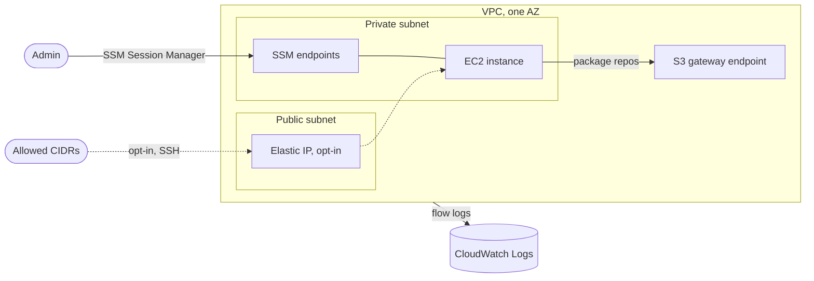

# AWS Simple VM

A single Linux EC2 instance. A public IP is optional and off by default.

OpenTofu demo template. Standalone, no dependency on other repos. Compatible with Terraform.

## Architecture



- VPC with one public and one private subnet in a single AZ
- Private subnet without an internet route. AWS services are reached through VPC endpoints (SSM, SSM Messages, EC2 Messages as interface endpoints, S3 as gateway endpoint for Amazon Linux package repos)
- EC2 instance (Amazon Linux 2023) with an IAM instance profile for SSM
- Security group: outbound HTTPS only, inbound only when the public IP is enabled
- Elastic IP and key pair (only when enabled)
- VPC flow logs to CloudWatch Logs

## Security

- IMDSv2 enforced, encrypted gp3 root volume, detailed monitoring
- Default: instance in the private subnet, no public IP, no inbound rules. Access through SSM Session Manager
- Public IP only on opt-in. Inbound traffic limited to `advanced_settings.allowed_ingress_cidrs` and `advanced_settings.allowed_ingress_ports`; `0.0.0.0/0` is rejected
- SSH with a key pair only
- Default security group of the VPC has no rules
- VPC flow logs capture all traffic

Accepted checkov findings (documented inline in the code):

| Check | Reason |
|---|---|
| CKV_AWS_338 | Log retention is configurable (`advanced_settings.log_retention_days`, default 90) |
| CKV_AWS_158 | Log group uses AWS-managed encryption, customer-managed KMS is out of scope |
| CKV_AWS_394 | Single-AZ demo, only the first zone is used |

## Usage

Configure AWS credentials, for example with `aws configure sso` or environment variables.

```bash
cp terraform.tfvars.example terraform.tfvars
tofu init
tofu plan
tofu apply
```

## Access

Default (no public IP), through SSM Session Manager. Needs the AWS CLI and the Session Manager plugin:

```bash
aws ssm start-session --target <instance_id> --region <region>
```

With `advanced_settings.enable_public_ip = true` and `ssh_public_key` set, SSH from an allowed CIDR:

```bash
ssh ec2-user@<public_ip>
```


## Inputs

| Name | Description | Default |
|---|---|---|
| `name_prefix` | Prefix for all resource names | `"demo"` |
| `region` | AWS region | `"eu-central-1"` |
| `instance_type` | EC2 instance type (x86_64) | `"t3.micro"` |
| `ssh_public_key` | SSH public key, `null` means SSM only | `null` |
| `advanced_settings` | Object with the settings below, all optional | `{}` |

`advanced_settings` attributes (shown as "Advanced Settings" in the StackGuardian form):

| Name | Description | Default |
|---|---|---|
| `vpc_cidr` | CIDR block of the VPC | `"10.0.0.0/16"` |
| `enable_public_ip` | Public subnet and Elastic IP | `false` |
| `allowed_ingress_cidrs` | Allowed source CIDRs, required with a public IP, `/0` rejected | `[]` |
| `allowed_ingress_ports` | Opened TCP ports | `[22]` |
| `log_retention_days` | Flow log retention | `90` |
| `tags` | Additional tags for all resources | `{}` |

## Outputs

| Name | Description |
|---|---|
| `instance_id` | ID of the EC2 instance |
| `private_ip` | Private IP |
| `public_ip` | Elastic IP, `null` if disabled |
| `ssm_command` | Command to open an SSM session |
| `ssh_command` | SSH command, `null` unless public IP and SSH key are set |

## Cost

The instance is billed hourly. The three interface endpoints are billed hourly per endpoint, also when idle. An Elastic IP is billed while allocated. CloudWatch Logs bills flow log ingestion and storage.

**Destroy after the demo:**

```bash
tofu destroy
```

## Tests

The GitLab pipeline (`.gitlab-ci.yml`) lints every push. Merge requests into `development` or `main` also run
validation, the checkov scan and the unit tests. A tag runs all of these plus the integration tests, which deploy
real resources and destroy them again, and then creates a release. Integration tests run only when the CI/CD variable `AWS_ROLE_ARN` is set: an IAM role trusted for GitLab OIDC with the audience `sts.amazonaws.com`. `AWS_REGION` is optional.

The GitHub Actions workflow (`.github/workflows/ci.yml`) runs the same jobs: every push, pull requests into `development` or `main`, and tags. Set `AWS_ROLE_ARN` (and optionally `AWS_REGION`) as repository variables; the IAM role then needs a trust for GitHub OIDC (`token.actions.githubusercontent.com`).

```bash
tofu test -test-directory=tests/unit
```

Test cases: [tests/README.md](tests/README.md)

## Development

```bash
pre-commit install
pre-commit run --all-files
```
